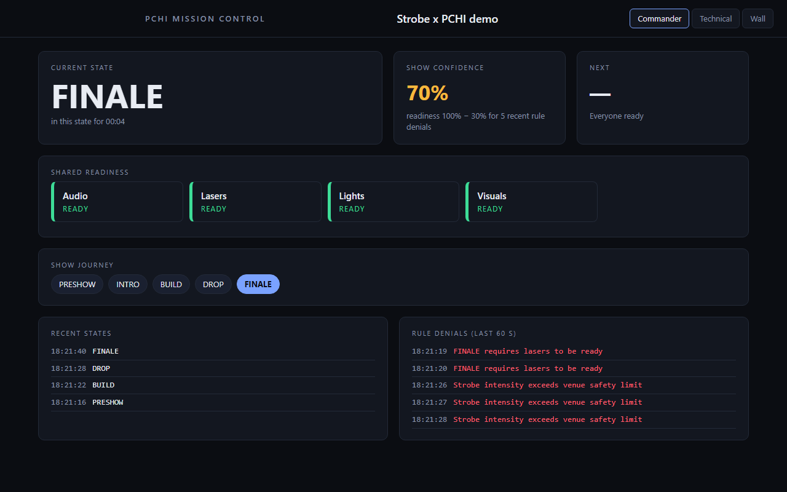
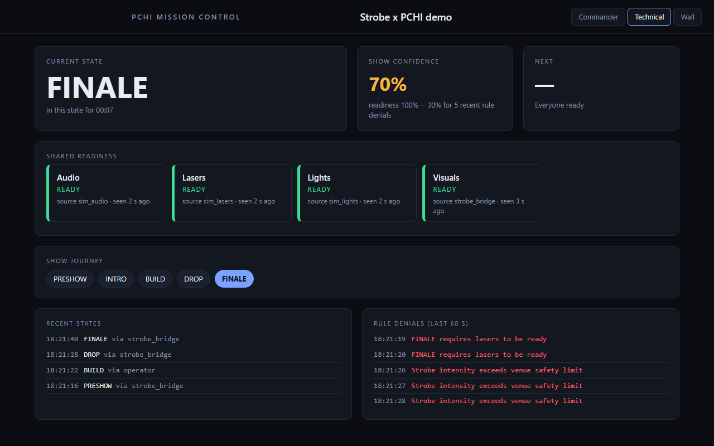

# Demo: Strobe × PCHI — Shared Show State

One Conductor, one rule, the real Strobe bridge, and a **Mission Control** page that answers *"where are we, who's ready, what's at risk?"* from what the tools actually reported.

```bash
./run_demo.sh          # scripted run, ~25 s, prints PASS/FAIL checks
./run_demo.sh --stay   # same, then keep running; open the page
# http://127.0.0.1:3000/mission-control
```

Needs Rust, Python 3 with `venv`, `curl`. The script creates a venv in `~/.cache/pchi-demo-venv` (override with `PCHI_DEMO_VENV`) and installs `python-osc`, `websocket-client`.

## What is real, what is simulated

| Real | Simulated |
|---|---|
| the Conductor (`primeswarm-pchi`) and its show-state model | **Strobe** — `fake_strobe.py` speaks Strobe's documented OSC addresses; it renders nothing |
| `strobe-pchi-bridge` (unmodified) | lights / audio / lasers departments — `pchi_show.py dept` |
| the Only-Lang rule and signed governance log | the "operator" who enters `BUILD` and ramps `strobe_intensity` |
| `GET /state`, `/mission-control` | |

Swap `fake_strobe.py` for a real Strobe (OSC on 9000, feedback to 9001) to run it for real; that path is **untested** — see the bridge README.

## What the run shows

1. Strobe's playlist is on cue 1 → Mission Control's current state is `PRESHOW`.
2. Lasers report `not_ready: safety check pending` → it appears under *At risk* and confidence is 75%, not 100%.
3. An operator enters `BUILD` from outside Strobe → the bridge sends `/strobe/cue/3`; Strobe goes to cue 3.
4. **Gating.** A rule says `show.entering == "FINALE" and readiness.lasers != "ready"` → deny. An operator asking for `FINALE` is refused and the show stays in `PRESHOW`. Then Strobe itself jumps to cue 5: the conductor refuses, tells the bridge (`rejected`), and the bridge sends Strobe back to cue 1. Each refusal is a signed receipt.
5. Lasers become ready; the strobe intensity ramps past 0.8 → the other rule denies it, and confidence drops by the denial penalty (max 30 points for 60 s).

Writing your own gate (see `strobe-show-rules.only-pchi`): `show.entering` is the state being requested, `readiness.<department>` is `ready | degraded | not_ready | offline | unknown` (a department that never reported is `unknown`, which is *not* ready), and `show.blockers` counts departments that aren't plainly ready.

## How confidence is computed

No invented numbers (`primeswarm-pchi/src/show.rs`):

- mean department readiness (ready = 1, degraded = ½, not ready / offline = 0), minus
- 10 points per rule denial in the last 60 s, capped at 30.
- A department whose source has been silent for 15 s is **offline** whatever it last claimed.
- With no department reporting, confidence is **"No data"**, never 100%.

## Display modes





Both were captured from this demo, with Strobe simulated; "Wall" is `docs/images/mission-control-wall.png`. Escape returns to commander mode.

`?mode=commander` (default: state, confidence, readiness), `?mode=tech` (adds sources and last-seen times), `?mode=wall` (state and confidence only, for a screen across the room).
